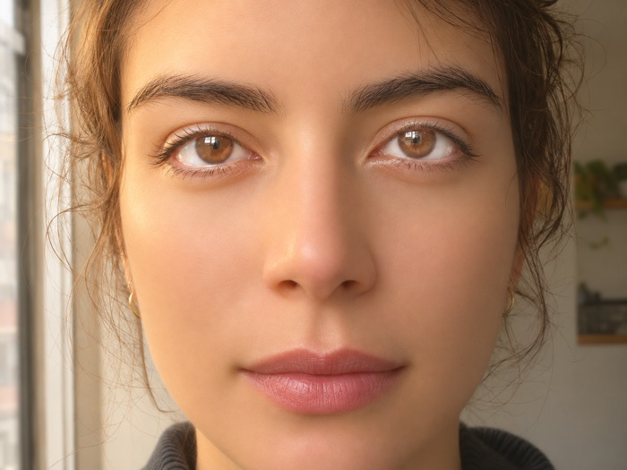
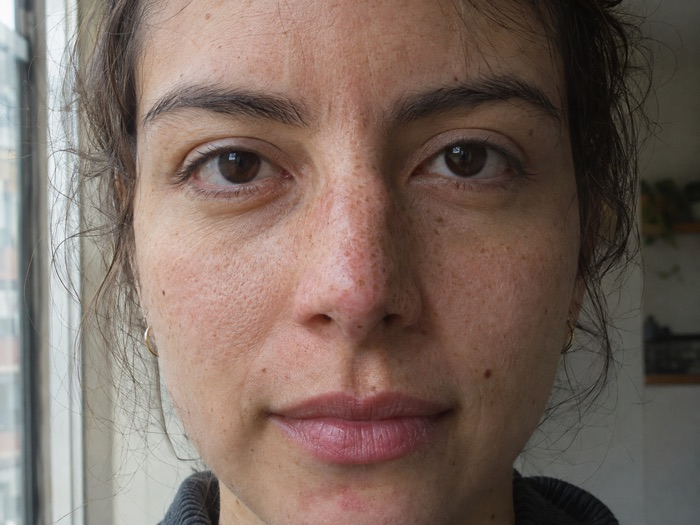

Las imágenes generadas con IA suelen delatarse por la piel de porcelana, la luz dorada de anuncio de perfume y los rostros repetidos. GPT Image Realism Engine (Revelado) es una skill que convierte una petición sencilla en un prompt listo para pegar en ChatGPT Images y en los modelos de imagen de OpenAI. Está pensada para quienes crean imágenes con IA y quieren que parezcan una fotografía encontrada, con piel, luz y desorden reales.





## Cómo funciona

La skill describe lo que una cámara podría registrar: luz, textura, encuadre y contexto. Por eso prohíbe palabras como *hyperrealistic*, *8k*, *cinematic* y *masterpiece*, que según el repositorio invocan justo el aspecto que delata a la IA.

Cada prompt se construye con cinco palancas:

| Palanca | Qué escribe la skill |
|---|---|
| Procedencia | Quién tomó la foto, con qué dispositivo y en qué situación real. Es la palanca más fuerte, porque el modelo imita el tipo de foto que describes. |
| Luz | Una fuente real y dónde cae, por ejemplo luz de ventana desde la izquierda de la cámara con la pared del fondo hundida en sombra. |
| Encuadre | Proporción de la imagen, distancia de cámara y un defecto de cámara cotidiano, como un horizonte torcido o un codo cortado. |
| Detalle físico | Dos o tres anclas por persona (poros, vello fino, desgaste de la ropa), sin pasar de ahí. |
| Restricciones | De tres a cinco exclusiones literales al final, como "sin luz de estudio, sin corrección de color, sin retoque". |

Además, la skill hace tres cosas:

- Elige un nivel de realismo: instantánea honesta, documental o forense.
- Describe a cada persona por separado, para que los grupos no salgan con la misma cara.
- Sitúa la escena en un lugar real y específico, en cualquier país e idioma.

## Instalación

### En Claude (claude.ai o app de escritorio)

1. Ve a **Settings → Capabilities** y activa **Code execution and file creation**.
2. Entra en **Customize → Skills → + → Upload a skill**.
3. Sube el archivo `dist/gpt-image-realism-engine.skill` del repositorio.
4. Pide algo en palabras simples, por ejemplo: "un mercado callejero en Hanoi de noche, que se vea real". Claude responde con el prompt.
5. Pega ese prompt en ChatGPT.

### En Claude Code

```
git clone https://github.com/lortbyron/gpt-image-realism-engine ~/.claude/skills/gpt-image-realism-engine
```

### En ChatGPT, Gemini u otro asistente

Abre `SKILL.md`, copia todo su contenido y pégalo como primer mensaje, seguido de esta instrucción: "Follow these instructions for everything I ask in this conversation." También puedes ponerlo en las instrucciones de un GPT personalizado o de un proyecto. Según el autor, queda algo menos preciso que la skill instalada, pero funciona.

### Sin instalar nada

El constructor gratuito de [imageeen.com](https://imageeen.com) aplica el mismo método en formato formulario y arma el prompt mientras escribes.

## Qué recibes

La respuesta incluye una línea de resumen (tipo de escena, nivel de realismo, procedencia, contexto y proporción), el prompt y las restricciones. Termina con una lista de ajustes para probar de a uno si el resultado aún parece IA, como describir a cada persona por separado cuando todos tienen el mismo rostro.

La skill responde en tu idioma y escribe el prompt siempre en inglés.

## Modelos compatibles

El repositorio lista ChatGPT Images 2.5, `gpt-image-2.5-flare` (predeterminado), `gpt-image-2.5-sunburst` y `gpt-image-2`. Los ajustes de API (tamaños, calidad, formato) se incluyen solo si indicas que usarás la API.

## Cuándo no usarla

El autor advierte que esta disciplina perjudica la ilustración, el anime, el pixel art, el 3D estilizado, los logos, los íconos, los diagramas y las maquetas de interfaz.

## Uso responsable

Una imagen que pasa por fotografía real puede engañar. Antes de escribir cualquier prompt, la skill aplica tres revisiones:

1. **Menores:** describe solo edad aproximada, ropa y actividad, sin detalles de piel ni cuerpo, y rechaza cualquier contenido sugerente.
2. **Personas reales:** rechaza reproducir el rostro de una persona real o famosa y ofrece una alternativa inventada.
3. **Registros falsos:** rechaza prompts pensados para hacerse pasar por noticias, pruebas o grabaciones de hechos reales.

Conserva los metadatos C2PA que ChatGPT incorpora en sus imágenes y señala como generado con IA lo que publiques.

## Crea tu propia derivación

La skill es universal a propósito y su licencia permite adaptarla. El autor sugiere un pack regional con la luz, la comida, las calles y los errores típicos de la IA de tu zona, un pack por rubro (restaurantes, inmobiliaria, moda) o un adaptador para otro modelo de imagen. Mantén las revisiones de uso responsable y la regla de describir física de cámara, y cambia el resto con libertad.

## Licencia

MIT: puedes usarla, modificarla y compartirla. El autor agradece que menciones el crédito.

## Mi experiencia

Tecnólogo creativo que desarrolla experimentos en inteligencia artificial, programación, 3D y web. Creador de The Vibecoding Show.